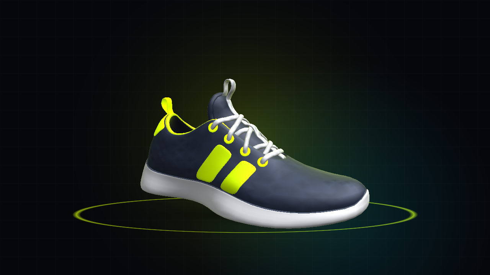
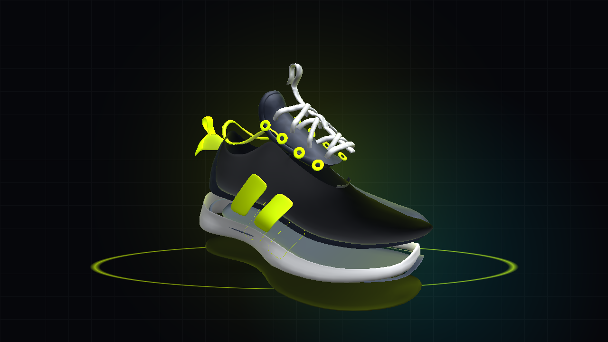
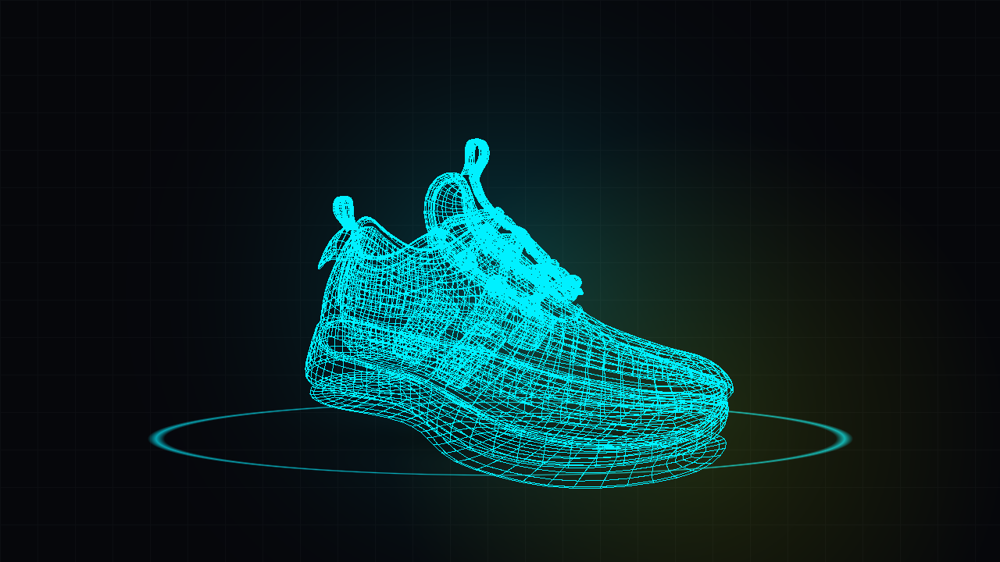
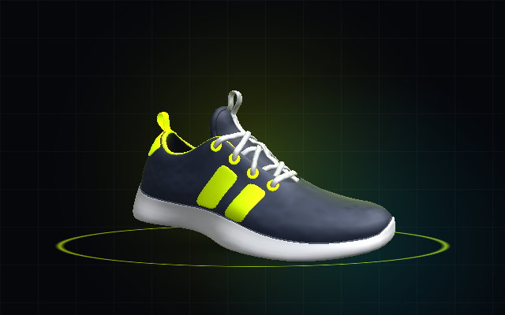
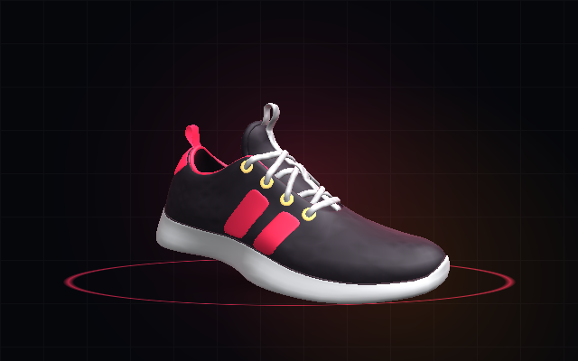
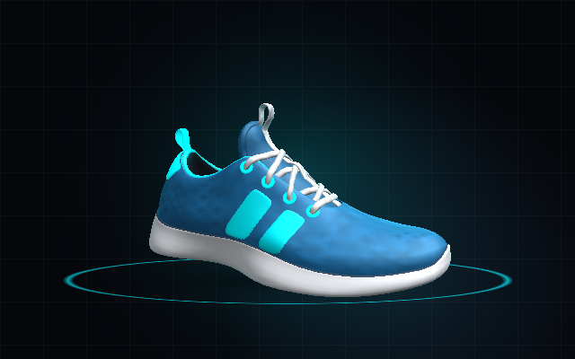
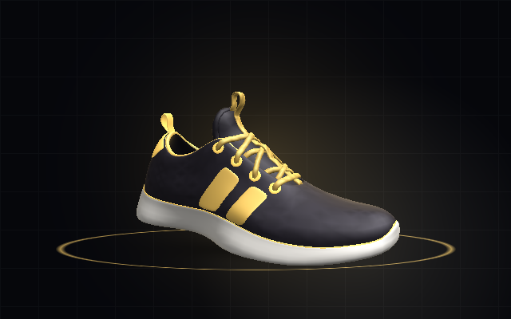

# ⚡ AETHER // APEX-01 — 3D Interactive Hyper-Footwear Showcase



> **Real-Time 3D Scanned Footwear Engineering, 12-Part Exploded Deconstruction, Bespoke 3D Atelier & 120FPS Lenis Smooth Scroll Choreography.**  
> Built with **React 19**, **TypeScript**, **Three.js (`@react-three/fiber` & `@react-three/drei`)**, **Lenis Smooth Scroll**, and **Tailwind CSS**.

---

## 🖼️ 3D Visual Showcase Gallery

### 1. Real-Time 3D Studio Hero & Turbine Pedestal


### 2. Interactive 12-Part 3D Exploded Deconstruction


### 3. Cyber-Cyan X-Ray CAD Wireframe Telemetry Mode


---

## 👟 Signature 3D Colorway Archive

| **CW-01 // VOLT PROTO** | **CW-02 // CRIMSON APEX** |
| :---: | :---: |
|  |  |
| *Obsidian Void / Cyber Volt / Alabaster AeroFoam* | *Stealth Anthracite / Hyper Crimson / Pure White* |

| **CW-03 // CRYO ZERO** | **CW-04 // PHANTOM GOLD** |
| :---: | :---: |
|  |  |
| *Midnight Ocean / Cryo Cyan / Glacier White* | *Velvet Onyx / 24K Champagne Gold / Ivory Foam* |

---

## ✨ Key Features

- **Authentic 3D Scanned Sneaker `.GLB` Architecture**:
  - Powered by a real photogrammetry/laser-scanned sneaker (`13,540` vertices, `22,700` triangles) partitioned losslessly across `83` connected sub-mesh islands into **12 independent anatomical nodes** (`public/models/aether-apex-01.glb`).
  - Paired with `2048×2048` baked tangent-space Normal (`shoe-normal.jpg`), Occlusion-Roughness-Metalness (`shoe-orm.jpg`), and multi-variant Diffuse (`shoe-diffuse-street.jpg`, `shoe-diffuse-midnight.jpg`, `shoe-diffuse-beach.jpg`) PBR maps.
- **120FPS Unified Lenis + WebGL Scroll Choreography**:
  - Zero-rerender mutable scroll store (`src/utils/scrollStore.ts`) ticked deterministically inside React Three Fiber's `LenisFrameTicker` (`priority -1`) so the 3D shoe pose and HTML scroll progress stay locked 1-to-1 on every frame.
- **12-Part Interactive 3D Exploded View**:
  - Disassemble the shoe in real time via scroll choreography or the interactive HUD Explode Slider to inspect individual components (`Outsole_Tread`, `Carbon_Torsion_Plate`, `Midsole_AeroFoam`, `Air_Energy_Pods`, `Upper_PrimeKnit`, `Overlays_Exoskeleton`, `Heel_Counter_Clip`, `Tongue_AeroMesh`, `Insole_Footbed`, `Eyelets_Hardware`, `Laces_CrossWeave`, `Signature_Blade_Logo`).
- **Bespoke 3D Atelier Customizer**:
  - Customize upper fabrics (`PrimeKnit`, `Matte Leather`, `Cyber Iridescent`), exoskeleton cage finishes (`TPU Satin`, `Forged Carbon`, `Brushed Alloy`), midsole pigments, neon NitroPods, lace cordage, titanium heel engraving, and 3D studio lighting atmospheres.
- **Aerodynamic Wind Tunnel & Biomechanics Telemetry**:
  - Toggle 260-particle GPU-instanced laminar airflow streams (`WindTunnelParticles.tsx`) and real-time cadence compression modes (`Idle`, `Walk`, `Tempo`, `Sprint`).

---

## 🛠️ Tech Stack

- **3D Engine**: Three.js (`r170`), `@react-three/fiber`, `@react-three/drei`
- **Smooth Scroll**: `lenis` (`v1.1+`) synchronized with R3F `useFrame`
- **Frontend**: React 19, TypeScript, Vite 6, Tailwind CSS, Lucide Icons
- **Audio**: Zero-dependency Web Audio API procedural UI & 3D telemetry synthesizer (`src/utils/soundEngine.ts`)

---

## 🚀 Quick Start

```bash
# 1. Install dependencies
npm install

# 2. (Optional) Rebuild 3D GLB assets & showcase renders
npm run generate:assets
node scripts/generate-showcase-images.mjs

# 3. Start development server
npm run dev

# 4. Build for production
npm run build
```
